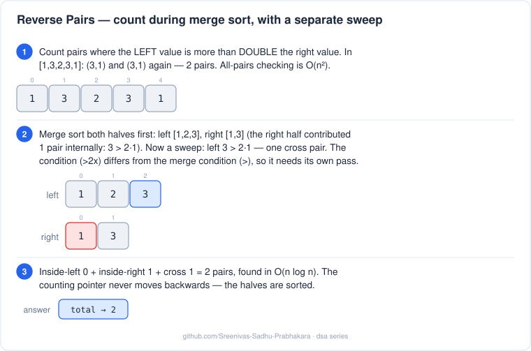

# Reverse Pairs

> Striver SDE Sheet 018 · Day 3 Arrays — merge sort with a separate monotone counting pass, since the pair condition isn't the merge condition. Go, stdlib only, tested.

## Problem

Count pairs (i, j) with i < j and nums[i] > 2·nums[j]. Like counting inversions, but the "greater than double" condition means the count can't be collected during the merge comparisons themselves.

## Approach

Merge sort again, but with a twist worth understanding: in plain inversion counting the merge comparison (`>`) and the counted condition are the same, so counting rides along. Here they differ, so each level does a dedicated counting sweep before merging: for every left element, advance a pointer over the (sorted) right half while `left > 2·right` holds. The pointer never moves backwards across left elements — the left half is sorted too — so the sweep is linear, not quadratic. Doubling is done in 64-bit to survive extreme 32-bit values; negatives need no special casing (`-5 > 2·(-5)` is correctly true).

**Complexity:** O(n log n) time, O(n) space.

## Visual walkthrough

Read the picture top to bottom — each numbered frame is one moment of the algorithm
running on this repo's test example.

## Run

    go test ./...   # verify
    go run .        # demo

---

One of 191 repos solving Striver's SDE Sheet in Go — stdlib only, one problem per repo, every solution tested. Browse the set: [`dsa-*` repos](https://github.com/Sreenivas-Sadhu-Prabhakara?tab=repositories&q=dsa-&type=source).
